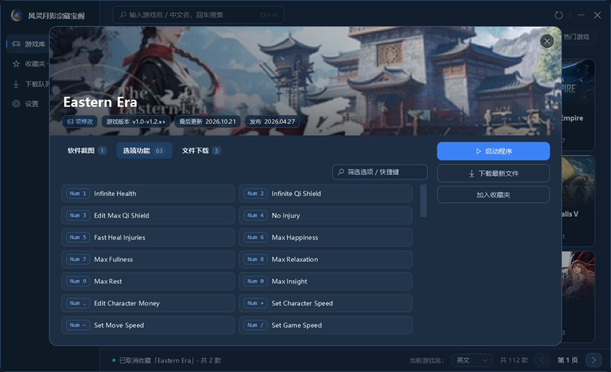
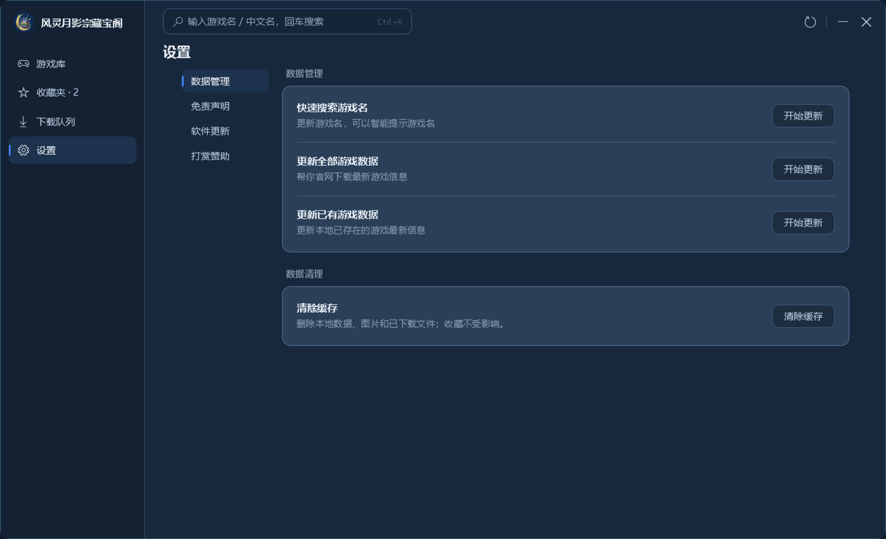

<div align="center">

# FlingTrainerX

A small Windows app that turns FLiNG Trainer into a local library you can search, browse and download from.


English · [简体中文](README.md)

</div>


## What it is

Finding a trainer used to mean paging through the website, filtering in a browser,
and remembering where the file ended up.

This app pulls the site's catalogue into a local library: open it and every listed game is
right there. Click one to see how many options it has, when it was last updated, and grab
the file directly.

It only organises and downloads — the files themselves are the originals.

## Features

- **Library** — card grid of every listed game, sortable by latest update or popularity
- **Search** — matches Chinese and English names (`Ctrl+K` focuses the search box)
- **Details** — trainer screenshot, option list and available files on one screen
- **Downloads** — one click into a queue with live progress and speed
- **Favorites** — pin the games you keep coming back to
- **Auto update** — checks for a new version on startup and installs it in-app

## Screens

**Detail dialog** — option list on the left, launch and download actions on the right



**Settings** — game data updates and local cache cleanup



## Tech stack

- Language: **C#**
- Runtime: **.NET 10**
- UI: **WPF**
- Local data: SQLite

## Running

Requires the [.NET 10 SDK](https://dotnet.microsoft.com/download).

```bash
git clone https://gitee.com/misslius/FlingTrainerX.git
cd FlingTrainerX
dotnet run --project FlingTrainerX
```

To build an installer, run `.pro\publish.bat`; the output lands in `.pro\<version>\`.
To publish a Gitee release, run `.pro\release.bat`.

## Notice

This project is **for learning and exchange only**. It is not commercial, and it is not sold
in any form.

- Trainer content, screenshots and text belong to [FLiNG Trainer](https://flingtrainer.com/)
  and the respective authors
- This app only organises and downloads; it does not modify or redistribute any file
- Using trainers may violate the terms of service of some games — use your own judgement
- Contact the author if anything here infringes your rights

If this project helps you, a star is appreciated.
