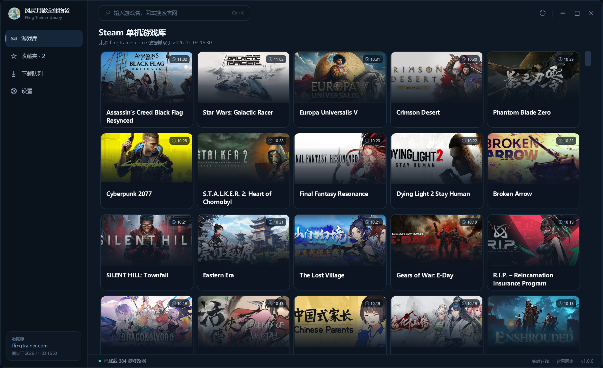
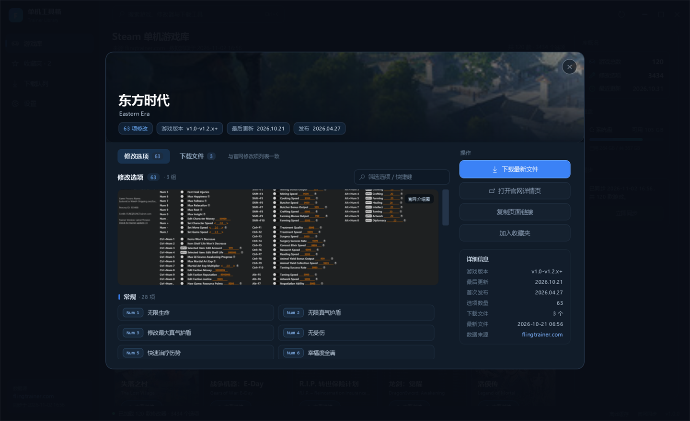
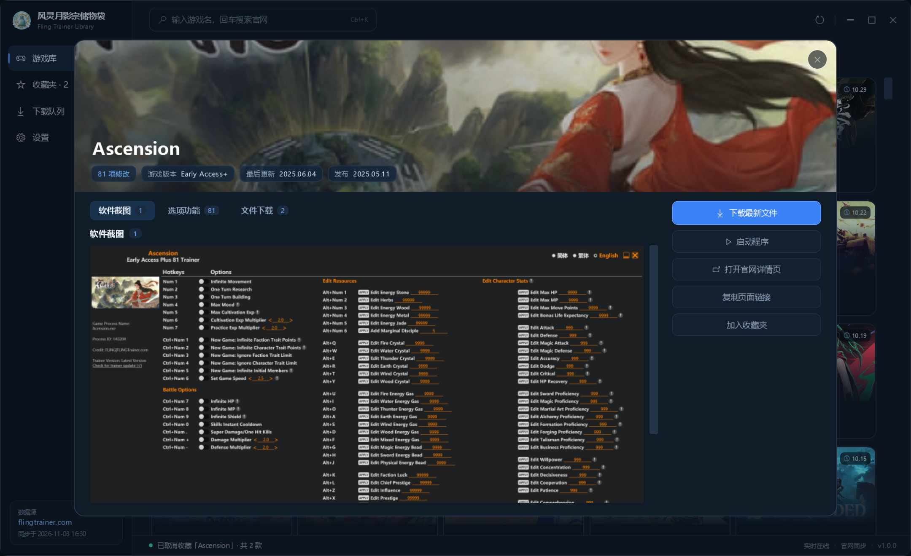
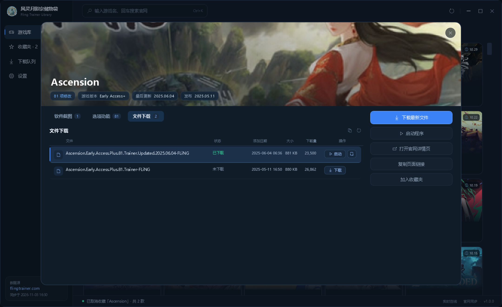
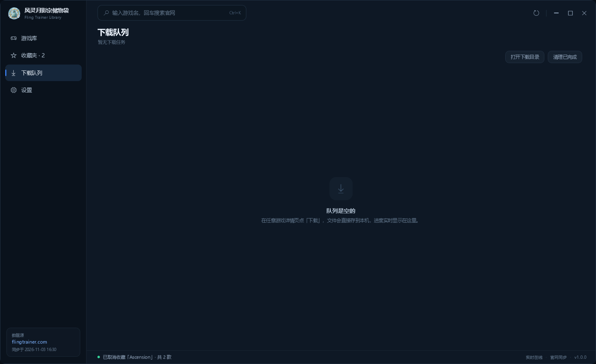
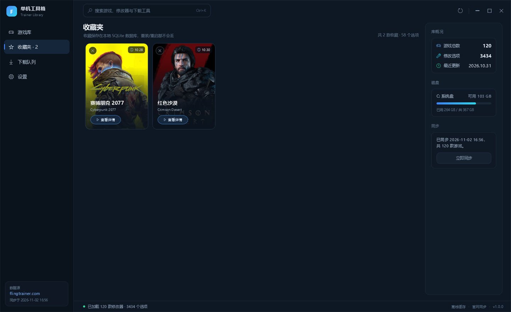

# 风灵月影宗藏宝阁 (FlingTrainerX)

**风灵月影宗藏宝阁** — a WPF desktop browser for [flingtrainer.com](https://flingtrainer.com/) game trainers:
launcher-style UI, data shown exactly as the site publishes it, and **in-app downloads** instead of
handing you off to a browser.













## Features

- **Fixed-width card wall, 5 per row, with UI virtualization** — the window is a fixed
  1440×880 (no resize, only hide-to-tray), and the card area uses a fixed content width:
  always **5 cards × 223 px** with 26 px side padding. If the work area is narrower than 1440,
  the whole window shrinks to fit (cards down to 130 px) instead of re-flowing columns.
  `ListBox + VirtualizingStackPanel`
  (`VirtualizationMode=Recycling`, `ScrollUnit=Pixel`, `CacheLength=1` page); only the visible rows
  are realized: with 384 games the visual tree never holds more than **8–14 rows
  (40–70 cards)**, no matter how far you scroll.
  Each card is a 16:9 cover (top corners rounded, bottom flush with the title strip) plus the
  title, the whole card is clickable, and hovering zooms the cover 1.08× inside its rounded clip.
- **One page per scroll** — `/page/N/` is fetched only when you get within a row of the bottom, and
  **never while the previous page is still in flight**; one scroll gesture triggers at most one
  request. Layout-driven `ScrollChanged` events (a page just grew the list) don't count as
  scrolling, so pages can't cascade. Wheeling at the very bottom re-checks even though the offset
  can't move, and a page that is entirely cache-duplicate rolls on to the next one (max 5 tries).
  The page you reached is kept in `dbs\library.page`, so a restart continues where it left off.
- **No library total in the header** — the API doesn't expose a stable "N games" figure, so the
  "N games · N options" chip is gone; the status bar only reports what has actually been loaded
  ("已加载 384 款修改器") and the footer says "已经到底了 · 共 N 款" once you hit the end.
- **Bounded image cache** — a decoded 520×292 cover costs 0.6 MB, so `NetImages` is an LRU capped
  at 160 images / 96 MB; covers scrolled out of view are released and re-decoded from
  `f\<id>\cover.jpg` on the way back (a few ms each).
- **Official site search** — typing does nothing; pressing **Enter** issues
  `/wp-json/wp/v2/posts?search=…`, i.e. the same results and ordering as the site's own `/?s=`
  page. Search results page in on scroll too, and clearing the box (Enter or `Esc`) returns to the
  library with its paging progress intact.
- **Card cache** — every fetched card is stored in the SQLite `trainer_cache` table (primary key
  `trainer_id` is **TEXT**, so a change to the site's ID scheme won't need a schema change), so the
  first screen is painted from disk in 1–2 s and refreshed from the site in the background; the
  refresh merges by post ID, so pages you already scrolled past stay in place, and the library still
  works offline.
- **Detail dialog** — banner, badges (`options / version / last updated / published`),
  and three tabs in a fixed order: **Screenshots** → **Options** → **Downloads** (opens on Screenshots).
  Close it with the × button, `Esc`, or **a click on the dimmed backdrop**; the panel keeps only
  headings and content — the grey hint lines are gone. The **game title on the banner is selectable**
  (drag / `Ctrl+C`), and the right column is just the five action buttons: no scrollbar, no "Actions"
  caption, no info card.
- **Options tab** — a flat two-column option list with hotkey badges, **no group headings and no
  "N items" captions**; names keep the site's original wording (no translation), filter by name or
  hotkey. Inline note paragraphs in the article body (e.g. the EasyAntiCheat instructions) are
  detected and dropped, so no description text trails the list; blank entries (no key/name, or
  punctuation-only placeholder rows) are discarded at parse time and never cached or shown.
- **Downloads tab** — mirrors the site's attachment table (`file / status / date / size / downloads /
  action`), showing **just the file name**, and downloads **directly into**
  `<app folder>\f\<post id>\`. The `status` column reads **Downloaded (green) / Not downloaded (grey) /
  Downloading (blue, real progress bar + percentage + `received / total`)** — the bar disappears once
  the file is complete. The site's response is chunked with no `Content-Length`, so the exact size is
  **probed separately**: the last 16 KB of the zip is fetched and its central directory parsed — the
  entry's uncompressed size is the exe's real byte count. Failing that it falls back to the table's
  size (marked `≈`), and after one successful download the real byte count is cached (`actualBytes`)
  so the next run is exact from the first byte.
  **Hovering a row selects it** (blue marker on the left) and the side panel's "Launch" button starts
  that row's file. Archives are located in Explorer instead of being executed.
- **Screenshots tab** — the article's inline images, one per row at 100% width with the height
  following the image's own aspect ratio (so they grow with the dialog), no hover outline; the first
  open saves them next to the cover, and clicking one opens the original.
- **Download queue** — live progress, speed and ETA per task; cancel / retry / open folder / remove;
  two concurrent downloads, the rest are queued.
- **Favorites** — stored in local SQLite via SqlSugar (`<app folder>\dbs\fling.db`),
  a full JSON snapshot per row so favorites survive cache loss.
- **Sync** — pulls `https://flingtrainer.com/wp-json/wp/v2/posts` on startup and on demand, and
  writes the result back into `trainer_cache`.
- **Browser-grade headers** — the site returns 403 to plain `HttpClient`; requests carry the local
  Edge UA (version read from the registry / `msedge.exe`) plus `sec-ch-ua`, `sec-fetch-*`, etc.
- **Online updates (Gitee releases)** — the app checks the Gitee release feed a few seconds after
  startup and offers a Steam-style "new version" dialog (version, release notes, update now). The
  Settings page has an **About** group with a manual "Check for updates" and a read-only
  "What's new" view. Downloading and installing is handled by
  [AutoUpdater.NET](https://github.com/ravibpatel/AutoUpdater.NET): its `ZipExtractor` waits for the
  process to exit, unpacks the update package over the install folder and relaunches the app
  (`dbs\` and `f\` are untouched).
- **PerMonitorV2 DPI awareness** — declared in `app.manifest`, window sized from the monitor's
  physical work area ÷ DPI scale, recomputed on `DpiChanged`.

## How downloads work

The site bounces you through three hops and **never sends `Content-Length`**:

```
/downloads/<slug>/  → 302 /download-trainer.php?...  → 302 .../xxx.exe
                        Content-Type: application/x-msdownload
                        Transfer-Encoding: chunked
```

So the progress bar has two modes: a percentage when the server gives a length, otherwise a
sweeping indeterminate bar plus the bytes received. The size printed on the page (e.g. "931 KB")
is **not** used as the denominator — the real file is 1.7 MB and the bar would stall at 100%.

Streaming write with an 80 KB buffer, `Stopwatch`-based speed, UI refreshed every 120 ms,
`CancellationTokenSource` for cancel, partial files removed on failure.

## Local cache: `trainer_cache` + the `f` folder

| What | Where |
| --- | --- |
| Card data (title / version / option groups / download table / local paths) | `dbs\fling.db`, table `trainer_cache`, one row per post with the whole object in `payload` |
| `cover.jpg`, `shot01.png`…, downloaded trainers | `f\<post id>\`, one folder per game |
| Last page reached (a plain number) | `dbs\library.page`, so a restart continues on the next page instead of re-fetching cached ones |

- Startup reads the cache first, renders, then requests page 1; covers are downloaded to
  `f\<id>\cover.jpg` three at a time and `CoverPath` raises `PropertyChanged` so the card switches
  from the remote URL to the local file without a rebuild.
- The cache table only stores cards, not "which page this came from", so the cursor lives in
  `dbs\library.page`. It resets to 1 whenever the cache is empty.
- **Every local path in the database is relative to the app folder** (`f\1142\cover.jpg`,
  `f\1142\xxx.exe`); `AppPaths.Resolve()` joins it with the current `AppContext.BaseDirectory` when
  the file is displayed or launched. Move the whole folder to another drive or rename it and covers
  plus downloaded trainers still work — nothing is pinned to a drive letter. Absolute paths from an
  older database are rewritten once on startup (`MigratePathsToRelative`).
- A finished download writes `LocalPath` back into `trainer_cache`, so the Launch button still works
  after a restart (no re-download, no duplicate copies).
- With no network the cached cards stay on screen and the subtitle says so; the empty state only
  appears when there is nothing cached at all.

## Parsing: AngleSharp, no regex

All HTML is parsed into a DOM with AngleSharp 1.9 (`HtmlParser.ParseDocument`, `QuerySelector`,
`QuerySelectorAll`) — the project contains zero regular expressions. Container is narrowed to the
article body and `script/style/noscript/svg` are removed before reading text, which is what used to
leak jQuery source into option names.

The **list** itself is not scraped from the homepage DOM. Each `<article>` there does carry
title, link, cover and timestamp (`.post-details-thumb` / `.post-title` / `.post-details-*` /
`.entry`), but the homepage returns only **15 posts per page** against **24** from
`wp-json/wp/v2/posts`, and the API's `content` already contains the full option groups, so the
detail modal opens instantly without a second request. The card timestamp is the `modified`
date, identical to what the API reports. Only the cover comes from `_embed=wp:featuredmedia`,
which yields the wide 520×292 header art instead of the site's 200×200 square crop.

## Content is left as published

Game titles, option names, group titles and platform names are displayed exactly as scraped —
no translation layer. The site is English, so most of it is English; a few group headings are
written in Chinese on the site itself (e.g. `常规`) and are passed through untouched.

UI chrome (tabs, table headers, buttons, status text) is written in Chinese independently of the
data and is not affected.

## Project layout

```
FlingTrainerX/
├─ app.manifest            PerMonitorV2 declaration
├─ Models/                 TrainerItem · CardRow · DownloadTask
├─ ViewModels/             DownloadRowVm · ShotVm
├─ Services/               TrainerWeb · TrainerFiles · DownloadManager · TrainerDataService
│                          AppPaths · NetImages · AppDatabase (SqlSugar/SQLite) · UserAgentProvider
├─ Converters/             image cache, visibility
├─ Themes/Theme.xaml       colors, cards, tabs, download rows, progress bars
├─ Views/TrainerDetailView detail dialog
└─ MainWindow              sidebar + card wall + queue + settings
```

## Build

```bash
dotnet build FlingTrainerX.slnx -c Release
dotnet run --project FlingTrainerX/FlingTrainerX.csproj
```

Requires the .NET 10 SDK (`net10.0-windows`); NuGet: `SqlSugarCore`, `AngleSharp`.

## Shortcuts

| Key | Action |
| --- | --- |
| `Ctrl + K` | Focus search |
| `Enter` | Run the official site search (typing alone never fires a request) |
| `Esc` | Close detail dialog; in the search box it clears the keyword and exits search |

> Besides `Esc` and the close button, **clicking the dimmed backdrop outside the dialog** also closes it
> (clicks anywhere inside the dialog do not).

## Disclaimer

For learning WPF, DOM parsing and download-queue design only. Trainer binaries and game artwork
belong to their respective authors and publishers; the app ships no trainer executables.
