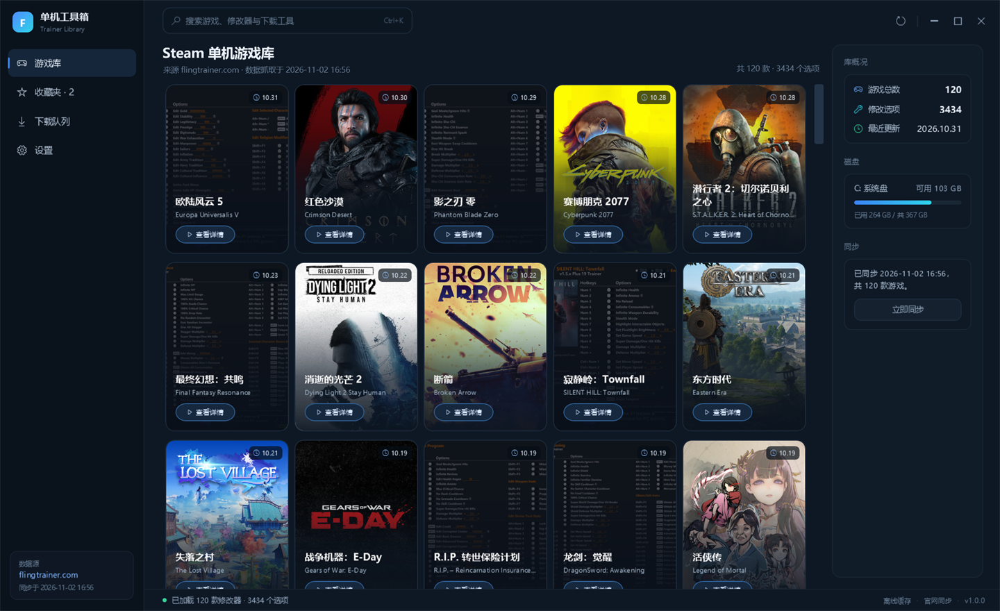
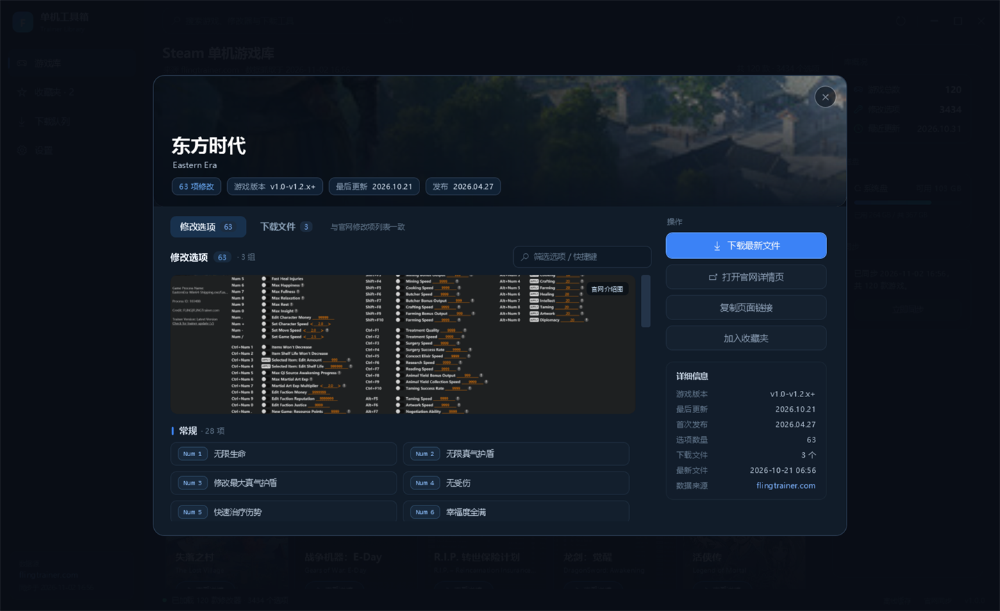
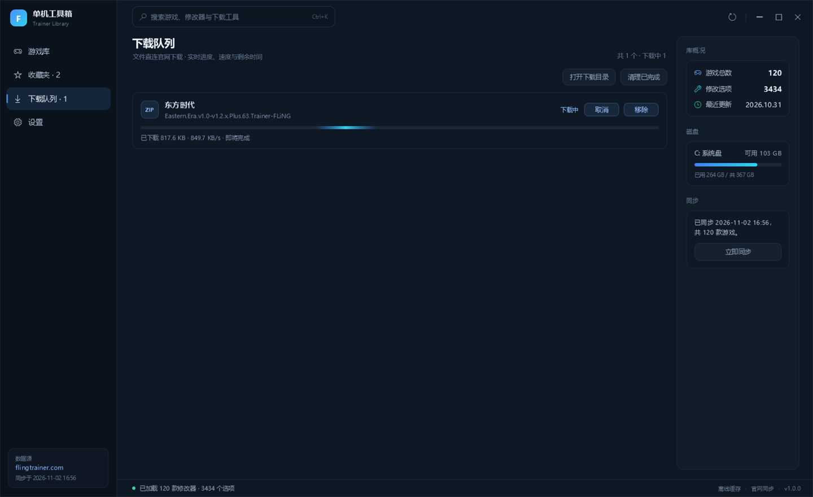

# FlingTrainerX

风灵月影宗工具箱 —— 一个 WPF 版的「单机游戏修改器」浏览器，界面参考现代化游戏启动器，
数据来自 [flingtrainer.com](https://flingtrainer.com/)。浏览器里能做的事，这里都能做：
翻游戏库、看修改项、**把修改器直接下到本机**。









## 功能

- **卡片墙：一行 5 张 + 虚拟化滚动**：卡片按可用宽度实时计算尺寸（高宽比固定 244:178），
  窗口缩放时整行等比伸缩，卡片不会变形。列表用 `ListBox + VirtualizingStackPanel`
  （`VirtualizationMode=Recycling`、`ScrollUnit=Pixel`）实现虚拟滚动，96 款游戏只创建 4 行容器，
  滚动不再掉帧。
- **滚动翻页**：官网首页是 `/page/2/` 这样的分页，对应 WordPress 接口的 `&page=N`。
  滚到距底约 480px 时自动抓取下一页追加到最后一行的空位，底部显示「正在加载下一页 / 已经到底了」，
  失败可点击重试；已加载的页数写进缓存，下次启动接着翻。
- **点击卡片弹出官网详情弹框**：横幅大图、中英文标题、`选项数 / 版本 / 最后更新 / 发布` 徽章、
  官网正文里的**介绍截图**，以及两个中文选项卡：**修改选项** / **下载文件**。
- **修改选项**：官网正文的介绍图 + 按官网分组的两列修改项（带 `Ctrl+Num 1` 快捷键徽章），
  **选项名全部中文**（`无限生命`、`无敌真气护盾`…），支持按中文名、英文名或快捷键筛选。
- **下载文件**：完整复刻官网下载表格 —— `文件`（含下载图标、文件名、下载地址）、
  `添加日期`、`文件大小`、`下载量`、`操作`，官网有几行就显示几行；点「下载」**直接存进本机**，
  不用跳浏览器，进度条就地出现在这一行里。
- **下载队列**：侧栏第三项，实时显示每个任务的进度条、已下载大小、速度、剩余时间，
  支持取消 / 重试 / 打开文件夹 / 移除、一键打开下载目录、清理已完成；最多 2 个任务并发，
  其余排队，进程退出后重新打开可继续。
- **收藏夹（本地 SQLite）**：详情页「加入收藏夹」写入 `%LOCALAPPDATA%\FlingTrainerX\fling.db`，
  收藏夹视图按收藏时间倒序展示，卡片左上角可直接取消收藏；库里没加载到的游戏用数据库里的
  JSON 快照还原，重启/翻页都不会丢。侧栏实时显示收藏数量。
- **官网数据同步**：右上角同步按钮 / 右侧「立即同步」会调用 WordPress REST 接口
  `https://flingtrainer.com/wp-json/wp/v2/posts` 重新抓取游戏名称、更新时间与修改项，
  结果缓存到 `%LOCALAPPDATA%\FlingTrainerX\library.json`，离线也能用。
- **搜索**：支持中文名 / 英文名 / 版本号 / 修改项名称（如 `cyber`、`无限生命`）。
- **浏览器 UA 伪装**：站点对 `python-requests`、空 UA 之类的请求直接返回 403，
  所以所有请求都带本机 Edge 的真实 UA（版本从注册表 / `msedge.exe` 现读）、
  `sec-ch-ua`、`sec-fetch-*`、`Accept-Language`（按系统语言）等一整套浏览器请求头。
  实测：`python-requests` → 403，本项目 UA → 200。
- **高 DPI 适配**：清单里声明 PerMonitorV2，100% / 150% / 200% 混合缩放、窗口在显示器之间拖动
  都不会糊也不会超出屏幕。
- 自绘标题栏、圆角卡片、悬停高亮、弹框淡入上滑动画。

## 直接下载与下载队列

官网的下载链路是三层跳转，而且**不返回 `Content-Length`**：

```
/downloads/eastern-era-v1-0-v1-2-x-plus-63-trainer-fling/
   └─ 302 → /download-trainer.php?...        （计数脚本）
        └─ 302 → /wp-content/uploads/.../xxx.exe
             Content-Type: application/x-msdownload
             Transfer-Encoding: chunked        ← 没有总大小
```

因此进度条分成两种形态：拿到 `Content-Length` 时显示百分比，拿不到时（官网常态）
显示**往返扫动的流光条 + 已下载字节数**——绝不拿官网页面上标注的「931 KB」当分母，
那个数字和实际文件（1.7 MB）对不上，用它会让进度条冲到 100% 再卡住。

| 环节 | 做法 |
| --- | --- |
| 请求 | `HttpCompletionOption.ResponseHeadersRead`，带文章页作 `Referer`，套本机 Edge 的 UA |
| 写盘 | 80KB 缓冲异步流式写入，文件名优先取 302 之后的真实文件名，重名自动加 `(2)` |
| 进度 | `Stopwatch` 算瞬时速度，UI 每 120ms 刷一次（不是每个 80KB 块都刷），剩余时间按滑动平均估 |
| 并发 | 最多 2 个并行，其余排队；`CancellationTokenSource` 取消，失败删残文件 |
| 落点 | `%USERPROFILE%\Downloads\FlingTrainerX`，详情行和队列卡片都能「打开文件夹」 |

代码集中在 `Services/DownloadManager.cs`（单例 + 排队）与 `Models/DownloadTask.cs`（状态机：
`Queued / Running / Completed / Failed / Canceled`，以及 `Progress`、`SpeedText`、`RemainingText`
等显示属性）。详情页的表格行由 `ViewModels/DownloadRowVm.cs` 把「官网下载记录」和「下载任务」
合成同一行，所以按钮会在 `下载 / 取消 / 重试 / 打开` 之间自动切换。

## 中文界面：选项名从哪来

官网 600 多个修改项是人写的自由文本，机翻基本不可用（`Edit Money` → 「编辑钱」）。
这里的做法是**精确表 + 规则兜底**：

```
Assets/option-zh.tsv    627 条对照（607 个选项名 + 18 个分组标题），覆盖率 100%
        ↓ 运行时由 TrainerZh 读取
Services/TrainerZh.cs
├─ Of(text)      查表命中直接用；没命中走 Compose() 按词根拼；再不行保留原文
├─ Compose()     Prefixes（Edit / Set / Unlimited …）× Nouns（Health / Chi / Score …）
├─ Platform()    Epic 商店 / 育碧 Connect / 战网 / Xbox 应用 …
└─ Normalize()   弯引号 ’‘“” 归一、不换行空格转空格、忽略大小写的比对
```

界面上的静态文案（选项卡、按钮、提示、队列状态）本来就直接写中文，这张表负责的是**来自官网的
数据**：选项名、分组标题、平台名。

## 网页解析：AngleSharp

早期版本用正则从 HTML 里抠数据，官网正文一变（同一行里塞了 `jQuery("document").ready(...)` 脚本）
就会抓出乱码。现在换成 AngleSharp 建 DOM 再查询，全项目已经**没有一处正则表达式**：

| 位置 | 做法 |
| --- | --- |
| 列表 / 分页 | `HtmlParser.ParseDocument(html)` → `QuerySelectorAll("article …")` 取标题、链接、时间 |
| 修改项 | 遍历正文段落与列表项，按「组标题 + `Ctrl+Num 1` – 名称」的结构切分 |
| 下载表 | `doc.QuerySelector("table.download-attachments")` → 逐行读单元格 |
| 介绍图 | `QuerySelectorAll("img")`，优先取 `srcset` 里 `-768x` 那一档 |
| 行内换行 | `(IElement)element.Clone(true)` 后把 `<br>` 换成 `\n`，再取 `TextContent` |
| 干扰节点 | 解析前先删 `script / style / noscript / svg`，并把容器收敛到正文根节点 |
| 空白折叠 | 手写 `Collapse()` 替掉 `\s+` 正则 |

## 高 DPI：PerMonitorV2

`app.manifest` 里同时声明新旧两套（新系统读 `dpiAwareness`，老系统读 `dpiAware`）：

```xml
<dpiAware xmlns="http://schemas.microsoft.com/SMI/2005/WindowsSettings">true/pm</dpiAware>
<dpiAwareness xmlns="http://schemas.microsoft.com/SMI/2016/WindowsSettings">PerMonitorV2</dpiAwareness>
```

窗口尺寸没写死，而是启动时按当前显示器工作区算：`MonitorFromWindow` + `GetMonitorInfo` 拿到
**物理像素**，再除以 `VisualTreeHelper.GetDpi(this)` 的缩放比换算成 DIP。窗口拖到另一块缩放不同的
屏幕上会触发 `OnDpiChanged`，重算一次；详情弹框有 `FitTo(w, h)`，在 960×520 这种小窗口
（模拟 200% 缩放下的 1080p）里也会自动收窄、右侧操作栏改为可滚动。

## 收藏夹：SqlSugar + SQLite（单例）

```
Services/AppDatabase.cs
├─ AppDatabase.Instance         Lazy<AppDatabase> 单例，内部持有一个线程安全的 SqlSugarScope
├─ FavoriteRow                  [SugarTable("favorite_trainer")] 收藏表
│    trainer_id(主键) / title / title_cn / url / version /
│    option_count / updated / poster / payload(TEXT) / created_at
├─ Save / Remove / GetAll / Count / Exists
└─ ImportLegacy                 老版本 state.json 自动迁移
```

- 库文件：`%LOCALAPPDATA%\FlingTrainerX\fling.db`，首次启动 `CodeFirst.InitTables` 自动建表。
- `payload` 列存整条 `TrainerItem` 的 JSON 快照，因此即使某款游戏在当前列表里没翻到，
  收藏夹也能正常渲染卡片。
- 数据库不可用（权限/文件损坏）时收藏功能退化为内存集合，不影响其它功能，设置页会显示错误原因。

## 首页虚拟滚动

原来的 `ScrollViewer + ItemsControl + WrapPanel` 会把所有卡片一次性创建出来，越翻越卡。
现在把数据按 5 个一行切成 `CardRow`，交给 `ListBox` 的 `VirtualizingStackPanel`：

| 做法 | 说明 |
| --- | --- |
| 行 = 虚拟化单位 | 行高固定（卡片高度 + 间距），容器可被回收复用 |
| `ScrollUnit=Pixel` | 保持像素级平滑滚动，滚动条手感不变 |
| `VirtualizationMode=Recycling` | 复用容器，翻页追加时不重建已生成的卡片 |
| 追加而不是重建 | 新一页只往最后一行塞，行满才新建一行，滚动位置不跳 |

实测 96 款游戏 / 20 行时，`ItemContainerGenerator` 只 realize 4 行（可见 4 行的量），
滚动到底部继续翻页依然稳定。

## 动画性能

弹框动画原来会明显掉帧，原因和对应改法：

| 问题 | 处理 |
| --- | --- |
| 详情面板用 `VisualBrush` 做圆角 `OpacityMask`，每帧重建中间渲染目标 | 去掉整块遮罩，横幅改用 `Rectangle + ImageBrush` 自带圆角 |
| 面板 `DropShadowEffect`、横幅 `BlurEffect`、卡片阴影 | 全部移除（卡片改用描边 + 圆角图形） |
| 卡片墙 24+ 个 `DropShadowEffect` 在遮罩淡入时被反复重绘 | 遮罩层改为不透明底色，不做整层淡入 |
| 打开时同步构建 46 行选项 + 测量，动画期间持续排版 | 先 `UpdateLayout()` 再动画；选项列表在动画结束后构建 |
| 图片解码 / 网络下载与动画抢 UI 线程 | 介绍图、封面全部异步解码（位图 `Freeze` 后回 UI 线程赋值） |
| 动画本身是缩放，导致文字逐帧重排 | 改成位移 + 透明度，并临时挂 `BitmapCache`，动画结束立刻摘掉 |

实测（`CompositionTarget.Rendering` 采样）：打开时的一次性布局从 **143ms 降到 48ms**，
动画期间帧间隔基本稳定在 16~19ms，入场动画时长 170ms。

## 数据来源

| 字段 | 来源 |
| --- | --- |
| 游戏名称 / 版本 / 平台 / 更新时间 / 选项数量 | 官网文章正文首行（`xx Options · Game Version: … · Last Updated: …`） |
| 修改项列表 | 官网文章正文，按「组标题 + 快捷键 – 名称」解析（AngleSharp DOM） |
| 修改项中文名 | `Assets/option-zh.tsv` 对照表 + 词根拼接兜底 |
| 介绍截图 | 官网正文第一张插图（优先取 srcset 里 768px 那一档） |
| 下载表格 | 官网详情页 HTML 里的 `.download-attachments` 表格（WordPress 正文接口不含此块） |
| 下载文件 | `/downloads/…` 三级跳转后的真实 `.exe`，带 `Referer` 直连 |
| 竖版海报 | Steam CDN `library_600x900.jpg`，按游戏名匹配 appid |
| 内置离线数据 | `Assets/trainers.json`（24 款游戏 / 829 个修改项 / 143 条下载记录，2026-11-02 抓取） |

## 项目结构

```
FlingTrainerX/
├─ app.manifest            PerMonitorV2 高 DPI 声明
├─ Assets/
│  ├─ trainers.json        内置数据（标题、版本、更新时间、分组选项、介绍图、下载表）
│  ├─ option-zh.tsv        修改项 / 分组标题的中英对照表
│  ├─ Covers/              官网截图（无海报时的兜底封面 / 详情介绍图）
│  └─ Posters/             Steam 竖版海报
├─ Models/
│  ├─ TrainerItem.cs       数据模型（含显示用计算属性、封面属性变更通知、中文名）
│  ├─ CardRow.cs           虚拟滚动的行容器（5 张卡片一行）
│  └─ DownloadTask.cs      下载任务状态机 + 进度 / 速度 / 剩余时间显示
├─ ViewModels/
│  └─ DownloadRowVm.cs     下载表格的一行：官网下载记录 + 下载任务
├─ Services/
│  ├─ TrainerWeb.cs        官网抓取 + AngleSharp 解析（列表分页 / 详情 / 下载表）
│  ├─ TrainerZh.cs         选项名中文化（对照表 + 词根拼接兜底）
│  ├─ DownloadManager.cs   下载队列（单例、2 并发、流式写盘、取消 / 重试）
│  ├─ TrainerDataService.cs 本地缓存 / 图片异步加载 / 收藏读写
│  ├─ AppDatabase.cs       SQLite（SqlSugar 单例）收藏表
│  └─ UserAgentProvider.cs 按本机 Edge 版本生成 UA 与浏览器请求头
├─ Converters/Converters.cs 图片缓存、可见性转换器
├─ Themes/Theme.xaml       配色、按钮、卡片、虚拟滚动列表、选项卡、下载行、进度条等样式
├─ Views/TrainerDetailView.xaml(.cs)  详情弹框（修改选项 / 下载文件 / 行内进度）
└─ MainWindow.xaml(.cs)    主窗口：侧栏 + 卡片墙 + 下载队列 + 设置
```

## 构建运行

```bash
dotnet build FlingTrainerX.slnx -c Release
dotnet run --project FlingTrainerX/FlingTrainerX.csproj
```

需要 .NET 10 SDK（`net10.0-windows`），NuGet 依赖：`SqlSugarCore`（含 `Microsoft.Data.Sqlite`）、
`AngleSharp`。

## 快捷键

| 按键 | 作用 |
| --- | --- |
| `Ctrl + K` | 聚焦搜索框 |
| `Esc` | 关闭详情弹框 |

## 说明

本项目仅用于学习 WPF 界面、DOM 解析与下载队列的实现，修改器文件与游戏素材版权归原作者 /
发行商所有。下载的 exe 由官网提供，是否使用、如何使用请自行判断，与作者无关。
