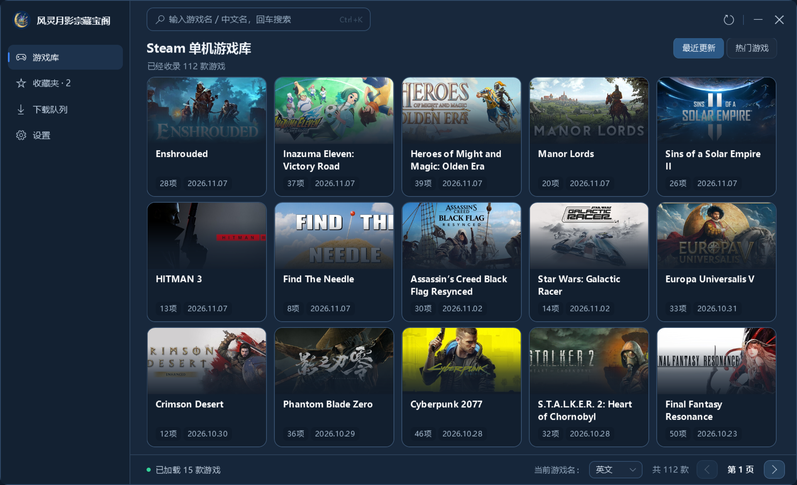

<div align="center">

# 风灵月影宗藏宝阁

把 FLiNG Trainer 上的游戏修改器，整理成一个能搜、能看、能下载的本地小工具。


[English](README.en.md) · 简体中文

</div>



## 这是什么

以前找修改器，要一页页翻官网、自己在浏览器里筛，下完还得记住放在哪。

这个小工具把官网的数据整理成一个本地库：打开就能看到收录的全部游戏，
点进去能知道这一款有多少个修改项、最近有没有更新，然后直接下载到电脑。

只做整理和下载，文件还是官网原版。

## 能做什么

- **游戏库**：卡片式浏览收录的游戏，可以按最近更新或热门排序
- **搜索**：中文名、英文名都能搜到（`Ctrl+K` 直接跳搜索框）
- **详情**：修改器截图、修改项清单、可用文件，一屏看完
- **下载**：点一下进下载队列，实时显示进度和速度
- **收藏夹**：常玩的几款挑出来，单独放一页
- **自动更新**：启动时检查新版本，发现新版就在程序里下载安装

## 界面

**详情弹框**：左边是修改项清单，右边是启动程序和下载入口


**设置**：游戏数据更新、本地缓存清理


## 技术栈

- 语言：**C#**
- 运行框架：**.NET 10**
- 界面：**WPF**
- 本地数据：SQLite

## 运行

需要 [.NET 10 SDK](https://dotnet.microsoft.com/download)。

```bash
git clone https://gitee.com/misslius/FlingTrainerX.git
cd FlingTrainerX
dotnet run --project FlingTrainerX
```

要打包成安装包，双击 `.pro\publish.bat`，产物在 `.pro\<版本号>\`。
要发布到 Gitee 发行版，双击 `.pro\release.bat`。

## 说明

本项目**仅供学习与交流**，不做任何商业用途，也不以任何形式售卖。

- 修改器内容、截图、文案版权归 [FLiNG Trainer](https://flingtrainer.com/) 及各修改器作者所有
- 本工具只做数据整理与下载，不修改、不二次分发文件内容
- 使用修改器可能违反部分游戏的用户协议，请自行判断，风险自负
- 若涉及侵权，请联系删除

如果这个项目对你有帮助，欢迎点个 Star。
