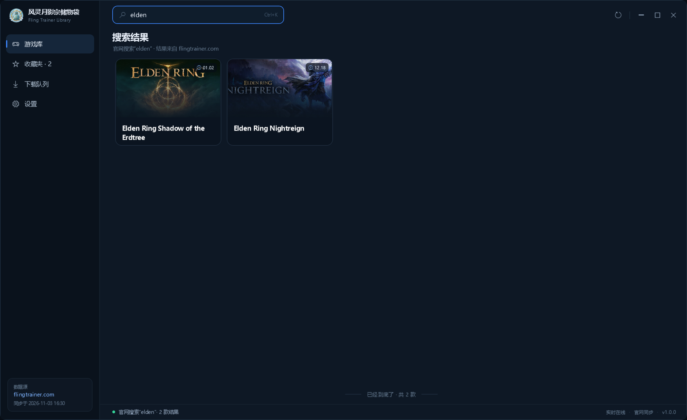
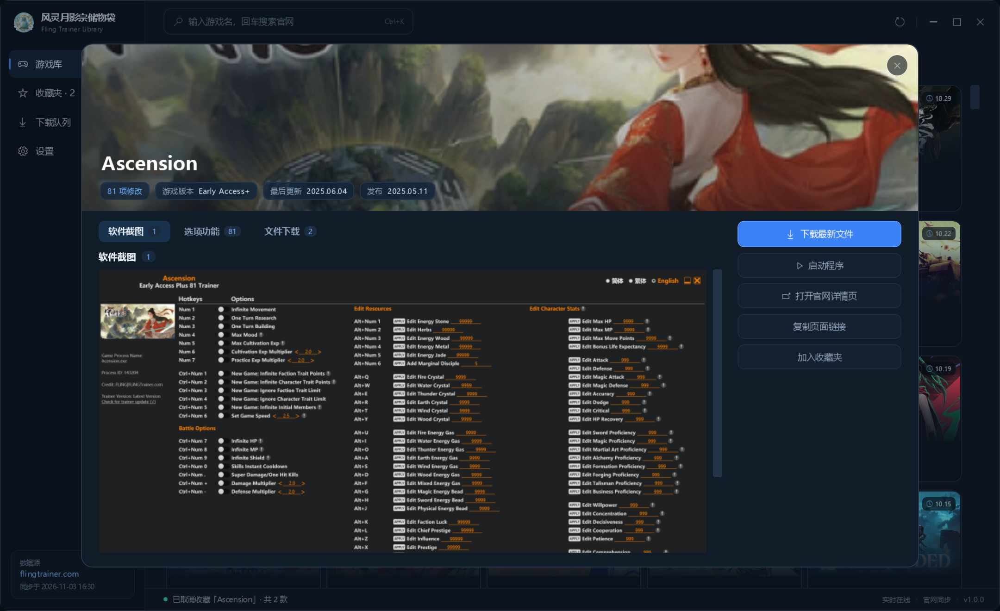
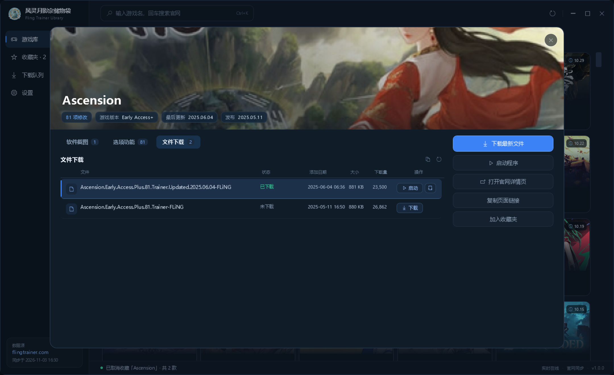
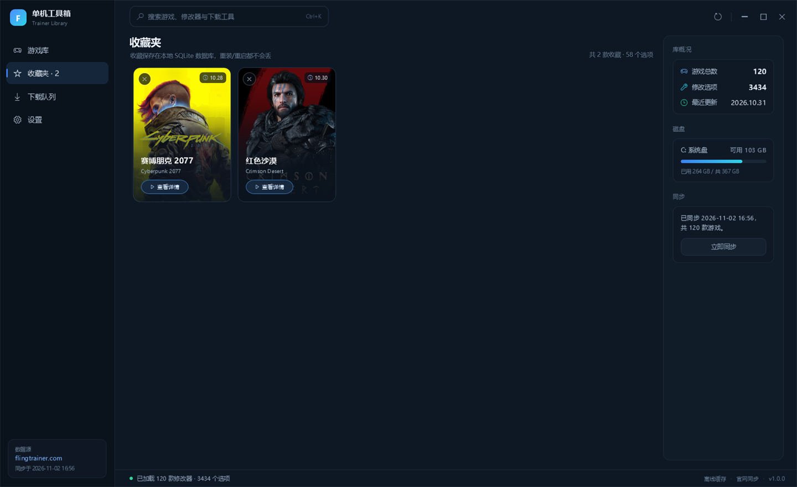

# 风灵月影宗藏宝阁 · FlingTrainerX

**风灵月影宗藏宝阁** —— 一个 WPF 版的「单机游戏修改器」浏览器，界面参考现代化游戏启动器，
数据来自 [flingtrainer.com](https://flingtrainer.com/)。浏览器里能做的事，这里都能做：
翻游戏库、看修改项、**把修改器直接下到本机**。












## 功能

- **卡片墙：固定版心、一行 5 张 + 虚拟化滚动**：卡片分两段 —— 上面是 **16:9 的封面区**（和官网头图同比例，
  用 `Stretch="Uniform"` 等比铺满，既不裁剪也不变形；只有上面两角是圆的，下面和标题区连成一片），
  下面是固定高度的标题区，**整卡可点**（没有多余按钮）。鼠标悬停时封面在圆角内轻微放大到 1.08 倍，
  退出回到原样。**窗口是固定尺寸（1440×880，不能拉大缩小）**，卡片区按固定版心排：
  一行恒定 **5 张 × 223 宽**，左右各留 26；屏幕工作区不足 1440 时窗口整体缩小到放得下，
  卡片最小 130，绝不溢出、也不会把列数改来改去。列表用 `ListBox + VirtualizingStackPanel`
  （`VirtualizationMode=Recycling`、`ScrollUnit=Pixel`、`CacheLength=1 屏`）实现虚拟滚动：
  实测 **77 行 / 384 款** 时，视觉树里始终只创建 **8~14 行（40~70 张卡）**，滚到最底也不会变多。
- **滚动翻页：一次只加载一页**：官网首页是 `/page/2/` 这样的分页，对应 WordPress 接口的 `&page=N`。
  滚到接近底部（一行的距离）时才抓下一页；**上一页没回来之前，再往下滚也不会发出第二个请求**，
  同一次滚动最多触发一页。内容尺寸变化（一页刚插进来）不算「用户滚动」，不会连锁自动加载。
  已经在底部、滚动位置不再变化时，继续滚轮也会补一次判断；整页都是缓存里已有的内容（启动时读过缓存）
  会自动顺延到下一页，最多连找 5 页。翻到第几页记在 `dbs\library.page`，重启后从下一页继续。
  底部显示「正在加载下一页 / 已经到底了」，失败可点击重试。
- **首页不报总数**：官网接口没有「一共多少款」这种可直接展示的完整数字（只有分页总数，且会随更新变化），
  所以标题右侧那枚「共 N 款 · N 个选项」的统计已经去掉，只在状态栏显示**已经真实加载到手的数量**
  （「已加载 384 款修改器」），到底时底部会说「已经到底了 · 共 N 款」。
- **首页卡片走本地缓存**：抓到的列表写进 SQLite 的 `trainer_cache` 表（主键 `trainer_id` 用 **TEXT**，
  官网 ID 规则变了也不用改表），启动时先把缓存铺到界面上（首屏 1~2 秒就有内容，不用等网络），
  再在后台向官网刷新；刷新时按 ID 合并，缓存里已经翻过的页不会被清空，断网也能照常浏览。
- **点击卡片弹出官网详情弹框**：横幅大图、标题、`选项数 / 版本 / 最后更新 / 发布` 徽章，
  以及三个中文选项卡，顺序是 **软件截图** / **选项功能** / **文件下载**（默认停在软件截图）。
  右上角关闭、`Esc`、**点弹框外的遮罩**都能关掉它。面板里只留标题和内容，不再挂「官网正文配图」
  「点下载直接存到本机」这类灰色说明小字；横幅上的**游戏名可以拖选 / `Ctrl+C` 复制**。
- **右侧只剩操作按钮**：下载最新文件 / 启动程序 / 打开官网页 / 复制链接 / 收藏，没有滚动条，
  也不再挂「操作」小标题和「详细信息」卡片（版本、更新时间这些横幅徽章里已经有了）。
- **启动修改器后自动让位**：点「启动程序」成功拉起修改器，主界面 0.6 秒后（先让 Toast 露个脸、
  也等修改器窗口先拿到前台）自动收进**右下角托盘**，不再挡着游戏。收起来用的是真正的 `Hide()`
  （SW_HIDE），**任务栏按钮、Alt+Tab 条目都不会留**，屏幕上只剩右下角那枚小图标，回来还是原来那个尺寸。
  托盘图标**左键**叫回主界面、**右键**弹出 Steam 风格小菜单 ——
  **打开主界面 / 退出程序**（34px 行高、5px 圆角悬停高亮、点菜单外或按 `Esc` 收起）。
  收进托盘是**静默**的，不弹气泡也不弹系统通知，托盘图标本来就在那儿。
  点窗口的 × 也是收进托盘，真退出要走托盘菜单的「退出程序」。
- **选项功能**：一张平铺的两列列表（带 `Ctrl+Num 1` 快捷键徽章），**不显示分组标题和「N 项」说明**，
  分组只用来切分数据；名称**保持官网原文不翻译**，支持按名称或快捷键筛选；正文里夹着的说明段落
  （例如「本作使用 EasyAntiCheat…」）会被识别出来丢掉，列表末尾不会多出一段描述文字；
  解析阶段就把空条目（快捷键或名字为空、整条只有标点/空白的占位行）直接丢掉，不写进缓存也不显示。
- **文件下载**：完整复刻官网下载表格 —— `文件`（只显示文件名）、`状态`、`添加日期`、`文件大小`、
  `下载量`、`操作`，官网有几行就显示几行。`状态` 列分别是 **已下载（绿） / 未下载（灰） / 正在下载（蓝，
  真实进度条 + 百分比 + `已下载 / 总大小`）**，下完进度条自动消失；**鼠标移到哪一行，哪一行就是选中行**
  （左侧一条蓝色竖线），右侧「启动程序」启动的就是这一行。点「下载」**直接存进本机**，不用跳浏览器，
  进度条就地出现在状态列里。（压缩包会先帮你在资源管理器里定位）
  官网的响应是 chunked、不给 `Content-Length`，所以真实总量是**另外问出来的**：取压缩包尾部 16KB
  解析 zip 中央目录，里面的「解压后大小」就是最终 exe 的字节数；问不到时退回表格里的大小并标 `≈`，
  下过一次之后会把真实字节数记进缓存（`actualBytes`），下次一开始就是准的。
- **软件截图**：官网正文里的介绍图，一张一整行铺满内容区宽度，高度按原图比例自适应
  （弹框放大缩小，图也跟着变），鼠标悬停不加描边；第一次打开时顺手存到本机，点任意一张用系统看图工具打开原图。
- **下载队列**：侧栏第三项，实时显示每个任务的进度条、已下载大小、速度、剩余时间，
  支持取消 / 重试 / 打开文件夹 / 移除、一键打开下载目录、清理已完成；最多 2 个任务并发，
  其余排队，进程退出后重新打开可继续。
- **收藏夹（本地 SQLite）**：详情页「加入收藏夹」写入 `<程序目录>\dbs\fling.db`，
  收藏夹视图按收藏时间倒序展示，卡片左上角可直接取消收藏；库里没加载到的游戏用数据库里的
  JSON 快照还原，重启/翻页都不会丢。侧栏实时显示收藏数量。
- **官网数据更新**：设置 → 数据更新里的「更新全部 / 更新已有游戏数据」，两条线**同时开跑、互不等待**：
  一条走官网列表 / 详情页刷新游戏名称、更新时间与修改项（写 `trainer_cache`），
  另一条走官网 [All Trainers 名录](https://flingtrainer.com/all-trainers/) 重建 `game_names`、再去 Steam 换中文名 ——
  两条线写不同的表，谁也不等谁，弹框里两条进度条各自跟着自己的线走。
- **快速更新游戏名**：设置 → 数据更新里的「快速搜索游戏名」，只解析官网
  [All Trainers (A-Z)](https://flingtrainer.com/all-trainers/) 一页名录（缺的数字开头 / 新上架条目
  再用一个很小的接口请求补齐），约 3 秒把 700 多款游戏写进 `game_names` 表 ——
  不抓详情、不查 Steam 中文名，已经换到的中文名按标题带过去。搜索框的智能提示靠它。
  点「开始更新」会先弹一个确认框，**可勾选「同时更新 Steam 中文名」**（默认不勾，勾了要逐款查 Steam，
  耗时会明显变长），点确认才真的开跑。它和上面两行共用同一套**模态**进度框
  （点遮层、按 `Esc` 都关不掉，只能点「取消更新」），读名录时逐条滚出游戏名，
  收尾写明多少款、保留了多少中文名。
- **搜索走官网**：输入过程中不发请求、不动列表，**按回车**才带 `search=` 参数向官网要结果
  （`/wp-json/wp/v2/posts?search=…`，和官网搜索页 `/?s=` 同一套结果与顺序），
  结果同样支持滚动翻页；清空后回车（或 Esc）回到原来的游戏库，翻页进度不受影响。
- **浏览器 UA 伪装**：站点对 `python-requests`、空 UA 之类的请求直接返回 403，
  所以所有请求都带本机 Edge 的真实 UA（版本从注册表 / `msedge.exe` 现读）、
  `sec-ch-ua`、`sec-fetch-*`、`Accept-Language`（按系统语言）等一整套浏览器请求头。
  实测：`python-requests` → 403，本项目 UA → 200。
- **高 DPI 适配**：清单里声明 PerMonitorV2，100% / 150% / 200% 混合缩放、窗口在显示器之间拖动
  都不会糊也不会超出屏幕。
- **设置页 · 一键清除缓存**：点按钮先弹确认框（取消 / 点遮罩 / `Esc` 都不会执行），
  确认后清空 SQLite 的 `trainer_cache` 表并删除 `f` 目录下的全部文件与子目录（收藏表不动）。
  清除期间缓存写入「静音」—— 在途的封面 / 修改器下载会被立刻取消并清掉半成品，
  之后多轮扫尾直到目录真的一尘不染；状态栏汇报清掉的记录数、文件数与总大小。
- **在线更新（Gitee 发行版）**：每次启动后自动查一次有没有新版本，查到就弹「发现新版本」
  （版本号 + 更新说明 + 立即更新）；设置页新增「关于」分组，可以手动「检查更新」，
  也可以只「查看更新」看发版说明。点「立即更新」由 AutoUpdater.NET 下载更新包、等程序退出后
  解压覆盖、再把新版本拉起来 —— 详见 [在线更新](#在线更新gitee-发行版)。
- 自绘标题栏、圆角卡片、悬停高亮 + 封面轻微放大、弹框淡入上滑动画。

## 直接下载与下载队列

官网的下载链路是三层跳转，而且**不返回 `Content-Length`**：

```
/downloads/eastern-era-v1-0-v1-2-x-plus-63-trainer-fling/
   └─ 302 → /download-trainer.php?...        （计数脚本）
        └─ 302 → /wp-content/uploads/.../xxx.exe
             Content-Type: application/x-msdownload
             Transfer-Encoding: chunked        ← 没有总大小
```

因此进度条分成两种形态：拿到 `Content-Length` 时显示百分比，拿不到时（官网常态）
显示**往返扫动的流光条 + 已下载字节数**——绝不拿官网页面上标注的「931 KB」当分母，
那个数字和实际文件（1.7 MB）对不上，用它会让进度条冲到 100% 再卡住。

| 环节 | 做法 |
| --- | --- |
| 请求 | `HttpCompletionOption.ResponseHeadersRead`，带文章页作 `Referer`，套本机 Edge 的 UA |
| 写盘 | 80KB 缓冲异步流式写入，文件名优先取 302 之后的真实文件名，重名自动加 `(2)` |
| 进度 | `Stopwatch` 算瞬时速度，UI 每 120ms 刷一次（不是每个 80KB 块都刷），剩余时间按滑动平均估 |
| 并发 | 最多 2 个并行，其余排队；`CancellationTokenSource` 取消，失败删残文件 |
| 落点 | `<程序目录>\f\<官网文章 ID>\`（一款游戏一个文件夹，不存在自动创建），详情行和队列卡片都能「打开文件夹」 |
| 启动 | 下完把本地路径写回 `trainer_cache`，详情行按钮变「启动」、右侧「启动程序」随之可用；`.exe` 直接跑，压缩包自动定位到资源管理器 |

代码集中在 `Services/DownloadManager.cs`（单例 + 排队）与 `Models/DownloadTask.cs`（状态机：
`Queued / Running / Completed / Failed / Canceled`，以及 `Progress`、`SpeedText`、`RemainingText`
等显示属性）。详情页的表格行由 `ViewModels/DownloadRowVm.cs` 把「官网下载记录」和「下载任务」
合成同一行，所以按钮会在 `下载 / 取消 / 重试 / 打开` 之间自动切换。

## 数据保持官网原文

游戏标题、修改项名称、分组标题、平台名都**直接显示官网上抓到的原文，不做翻译**。
官网是英文站，所以这些内容以英文为主；少数分组标题官网本身写作中文（例如「常规」），
解析器原样保留，不做任何语言判断或改写。

界面自身的文案（选项卡、表头、按钮、提示、队列状态）是项目里写死的中文，
与数据内容分开，两者互不影响。

## 网页解析：AngleSharp

早期版本用正则从 HTML 里抠数据，官网正文一变（同一行里塞了 `jQuery("document").ready(...)` 脚本）
就会抓出乱码。现在换成 AngleSharp 建 DOM 再查询，全项目已经**没有一处正则表达式**：

| 位置 | 做法 |
| --- | --- |
| 列表 / 分页 | 不走 DOM：请求 `wp-json/wp/v2/posts`，`_embed=wp:featuredmedia` 顺带把头图带回来 |
| 详情页 | `HtmlParser.ParseDocument(html)` → `QuerySelector` 取下载表与介绍图 |
| 修改项 | 遍历正文段落与列表项，按「组标题 + `Ctrl+Num 1` – 名称」的结构切分 |
| 下载表 | `.download-attachments` 容器 → 逐行读单元格（表格类名是 `da-attachments-table`） |
| 介绍图 | `QuerySelectorAll("img")`，优先取 `srcset` 里 `-768x` 那一档 |
| 行内换行 | `(IElement)element.Clone(true)` 后把 `<br>` 换成 `\n`，再取 `TextContent` |
| 干扰节点 | 解析前先删 `script / style / noscript / svg`，并把容器收敛到正文根节点 |
| 空白折叠 | 手写 `Collapse()` 替掉 `\s+` 正则 |

### 首页卡片：`article` 里什么都有，但列表仍走接口

官网首页的一个 `<article>` 确实自带卡片需要的全部信息：

```html
<article id="post-42920" class="…">
  <div class="post-details">
    <div class="post-details-thumb">          ← 封面（img 的 srcset 有 200/150/45 三档）
      <a href="/trainer/…-trainer/"></a>
    </div>
    <div class="post-details-day">02</div>    ← 更新日期（年 / 月 / 日分三个 div）
    <div class="post-details-month">Nov</div>
    <div class="post-details-year">2026</div>
  </div>
  <div class="post-content">
    <h2 class="post-title"><a href="…">Assassin's Creed Black Flag Resynced Trainer</a></h2>
    <div class="entry">30 Options · Game Version: v1.0-v1.0.x+ · Last Updated: 2026.11.02</div>
  </div>
</article>
```

实测过两种方式，最后**列表还是走 REST 接口**，理由是三条：

- **每页条数**：首页一页只有 **15 条**，接口是 **24 条**。改用 HTML 会让翻页次数多出 60%。
- **选项列表**：接口的 `content` 里带完整的选项分组，点开弹框立刻就能显示；首页 `article` 只有一个
  「30 Options」的数字，换成 HTML 就得每点一次卡片再请求一次详情页。
- **日期口径**：`post-details-day/month/year` 取的是 `modified`（最后更新），不是发布日 ——
  拿 `Europa Universalis V` 对照过：发布 `2025-11-04`、修改 `2026-10-31`，卡片显示 `31 Oct 2026`。
  这点和接口给的 `modified` 完全一致，所以走接口不会丢信息。

唯一的收获是**封面**，也就是下面这条：首页 `post-details-thumb` 里引的是 `header-200x200.jpg`
（官网把宽幅头图裁成正方形），而接口 `_embed` 能拿到同一张图的 `520×292` 宽幅档，正好适合卡片比例。
代价只是每页多 8.6 KB JSON，比正文首图（1926×1157、单张 779 KB）小 14 倍。

## 高 DPI：PerMonitorV2

`app.manifest` 里同时声明新旧两套（新系统读 `dpiAwareness`，老系统读 `dpiAware`）：

```xml
<dpiAware xmlns="http://schemas.microsoft.com/SMI/2005/WindowsSettings">true/pm</dpiAware>
<dpiAwareness xmlns="http://schemas.microsoft.com/SMI/2016/WindowsSettings">PerMonitorV2</dpiAwareness>
```

窗口尺寸没写死，而是启动时按当前显示器工作区算：`MonitorFromWindow` + `GetMonitorInfo` 拿到
**物理像素**，再除以 `GetDpiForWindow` 的缩放比换算成 DIP（用它而不是视觉树的 DPI，
跨屏拖动时它和 `MonitorFromWindow` 才是同一套数据）。窗口拖到另一块缩放不同的屏幕上会触发
`OnDpiChanged`，等布局走完再重算一次，避免拿「新 DPI + 旧显示器」算出一个偏小的尺寸。

**窗口圆角**：`DwmSetWindowAttribute(hwnd, DWMWA_WINDOW_CORNER_PREFERENCE, DWMWCP_ROUND)`，
Windows 11 由系统负责圆角（自带抗锯齿和阴影）；内容侧再给根 `Border` 套一个
`RectangleGeometry` 裁剪，侧栏和图片不会溢出到圆角外面。**最大化时反切成 `DWMWCP_DONOTROUND`**，
描边也一起去掉，四角才贴得住屏幕边。

**最大化为什么不是全屏**（窗口改成固定尺寸后不再有最大化按钮，这段是保留的兜底：系统快捷键
`Win+↑` 之类的路径仍可能把窗口最大化）：`WindowStyle="None" + WindowChrome` 的窗口，系统默认给的最大化矩形是按
**整个显示器**算的，而且窗口还会被往外撑一圈隐形边框（本机 96 DPI 下 7px）。结果是上面和左边跑到屏幕外、
右边和下边贴不到边，底部状态栏还会伸到任务栏底下被裁掉。所以接管了 `WM_GETMINMAXINFO`：
用 `GetWindowRect` − `GetClientRect` 实测出那圈隐形边框，再按 `GetMonitorInfo` 的**工作区**
（任务栏以上）反推出 `ptMaxSize / ptMaxPosition`，最大化后内容区正好 1920×1032。
接管这条消息后系统不再补默认值，`ptMinTrackSize`（= `MinWidth/MinHeight`）和 `ptMaxTrackSize`
也要自己填，否则窗口会被压成最小尺寸。

**固定尺寸**：窗口 **1440×880**，`ResizeMode=NoResize`，标题栏不再有最大化按钮、双击也不最大化
（要腾地方就收进托盘）。只有工作区本身放不下 1440×880 时（比如 1080p + 150% 缩放），
`ApplyWindowBounds` 会按 `工作区 − 32` 等比缩小到放得下，卡片区跟着缩（最小 130 宽），不会溢出。

**详情弹框按百分比**：不再固定 1000×664，改成窗口的 **84% 宽 × 86% 高**，下限 700×500。
窗口尺寸变了（换屏 / 换缩放）时 `FitTo` 重算，只在数值真的变了才改，避免反复触发布局。

## 收藏夹：SqlSugar + SQLite（单例）

```
Services/AppDatabase.cs
├─ AppDatabase.Instance         Lazy<AppDatabase> 单例，内部持有一个线程安全的 SqlSugarScope
├─ FavoriteRow                  [SugarTable("favorite_trainer")] 收藏表
│    trainer_id(主键, TEXT) / title / url / version /
│    option_count / updated / payload(TEXT) / created_at
├─ Save / Remove / GetAll / Count / Exists
└─ ImportLegacy                 老版本 state.json 自动迁移
```

- 库文件：`<程序目录>\dbs\fling.db`，目录不存在自动创建；首次启动 `CodeFirst.InitTables` 自动建表。
- 从旧版本升级时，若新位置还没有库、`%LOCALAPPDATA%\FlingTrainerX\fling.db` 存在，会先复制过来一次。
- `payload` 列存整条 `TrainerItem` 的 JSON 快照，因此即使某款游戏在当前列表里没翻到，
  收藏夹也能正常渲染卡片。
- 数据库不可用（权限/文件损坏）时收藏功能退化为内存集合，不影响其它功能，设置页会显示错误原因。

## 首页虚拟滚动

原来的 `ScrollViewer + ItemsControl + WrapPanel` 会把所有卡片一次性创建出来，越翻越卡。
现在把数据按 5 个一行切成 `CardRow`，交给 `ListBox` 的 `VirtualizingStackPanel`：

| 做法 | 说明 |
| --- | --- |
| 行 = 虚拟化单位 | 行高固定（卡片高度 + 间距），容器可被回收复用 |
| `ScrollUnit=Pixel` | 保持像素级平滑滚动，滚动条手感不变 |
| `VirtualizationMode=Recycling` | 复用容器，翻页追加时不重建已生成的卡片 |
| `CacheLength=1 屏` | 视口前后各只留一屏容器，滚得再远也不多建 |
| 追加而不是重建 | 新一页只往最后一行塞，行满才新建一行，滚动位置不跳 |

实测 384 款 / 77 行时，视觉树里始终只有 **8~14 行（40~70 张卡）**，滚到底、继续翻页都不变。

**内存还有一半在图片上**：一张 520×292 的封面解码后就是 0.6 MB，整库几百款全留在内存里能吃掉几百兆。
`NetImages` 因此改成有上限的 LRU（最多 160 张 / 96 MB）：滚过去的图直接从表里丢出去交给 GC，
再滚回来时从本地 `f\<id>\cover.jpg` 重新解码（一张十几毫秒，看不出来）。
实测连续滚动时这个缓存会停在上限（160 张 / 92 MB）不再增长，滚动结束 GC 后工作集回落。

## 详情弹框的版式

| 部位 | 规则 |
| --- | --- |
| 弹框尺寸 | 窗口可用区的 84% × 86%，下限 700×500（窗口比下限还小时以窗口为准，绝不溢出）；窗口尺寸变了就重算（`FitTo`） |
| 选项卡 | 顺序固定为 **软件截图 → 选项功能 → 文件下载**，默认停在软件截图；切换只是显隐面板，选项列表在弹框动画结束后才构建 |
| 顶部横幅 | 高度 = 弹框宽度 × 0.24（夹在 128~240，且不超过弹框高的 34%）—— 比之前矮一截，把竖向空间多留给下面的列表；图片 `UniformToFill` **横向铺满**，等比缩放不拉伸；`BitmapScalingMode=HighQuality` 让 520×292 的源图放大后不发糊 |
| 顶部圆角 | 面板 `CornerRadius=16`；横幅另外按实际尺寸生成「上圆下方」的 `StreamGeometry` 做 `Clip`（半径 15）。只给各层 Border 写 `CornerRadius` 不够 —— 虚化底衬的 `BlurEffect` 会把半透明像素糊到圆弧外面，把方角填成一块灰 |
| 亮度 | 只压左下角（横向渐变 + 底部渐变），右侧基本保留原图；弹层遮罩 `#5C080D15`（约 36%），能看见后面的卡片墙 |
| 软件截图 | 一张一整行 `Stretch="Uniform"`，宽度 100%、高度按原图比例自动算，弹框放大图片跟着放大；悬停不加描边 |
| 下载表选中行 | 鼠标移入某一行即选中（`IsSelected` 高亮 + 左侧蓝色竖线），右侧「启动程序」启动选中的那一行；默认选中第一个已下载的文件 |
| 状态列 | 宽度 112：第一行 `正在下载 + 69%`，第二行 5px 真实进度条（按已下载/总字节数），第三行 `1.2 MB / 1.7 MB`；只在下载中出现，下完自动收起 |
| 右侧操作栏 | 普通 `StackPanel`，没有 `ScrollViewer`（内容固定，矮窗口也不出现滚动条），只有 5 个按钮 + toast |

## 动画性能

弹框动画原来会明显掉帧，原因和对应改法：

| 问题 | 处理 |
| --- | --- |
| 详情面板用 `VisualBrush` 做圆角 `OpacityMask`，每帧重建中间渲染目标 | 横幅改成「`Border` 背景 + `ImageBrush`」，圆角交给 `Border` 自己裁 |
| 面板 `DropShadowEffect`、横幅 `BlurEffect`、卡片阴影 | 面板/卡片阴影移除（改用描边 + 圆角图形），横幅只保留一层低透明度虚化底衬 |
| 卡片墙 24+ 个 `DropShadowEffect` 在遮罩淡入时被反复重绘 | 遮罩只留一层半透明底色（`#5C080D15`），不做整层淡入 |
| 打开时同步构建 46 行选项 + 测量，动画期间持续排版 | 先 `UpdateLayout()` 再动画；选项列表在动画结束后构建 |
| 图片解码 / 网络下载与动画抢 UI 线程 | 封面全部交给 WPF 在线加载（`CacheOption.OnDemand`，后台下载解码），不落盘也不占 UI 线程 |
| 动画本身是缩放，导致文字逐帧重排 | 改成位移 + 透明度，并临时挂 `BitmapCache`，动画结束立刻摘掉 |

实测（`CompositionTarget.Rendering` 采样）：打开时的一次性布局从 **143ms 降到 48ms**，
动画期间帧间隔基本稳定在 16~19ms，入场动画时长 170ms。

## 数据来源

| 字段 | 来源 |
| --- | --- |
| 游戏名称 / 版本 / 平台 / 更新时间 / 选项数量 | 官网文章正文首行（`xx Options · Game Version: … · Last Updated: …`） |
| 修改项列表 | 官网文章正文，按「组标题 + 快捷键 – 名称」解析（AngleSharp DOM） |
| 卡片封面 | 接口 `_embed=wp:featuredmedia` 带回的官网头图（取 520×292 档），WPF 直接按地址在线加载 |
| 介绍截图 | 官网正文第一张插图（优先取 srcset 里 768px 那一档），详情页弹框左侧展示 |
| 下载表格 | 官网详情页 HTML 里的 `.download-attachments` 表格（WordPress 正文接口不含此块） |
| 下载文件 | `/downloads/…` 三级跳转后的真实 `.exe`，带 `Referer` 直连 |

**图片不裁剪、只等比缩放**：`Services/NetImages.cs` 是唯一入口，本地文件直接读盘
（`CacheOption.OnLoad`，读完就释放句柄），网络地址交给 WPF（`CacheOption.OnDemand`，
下载解码都在后台线程）；同一来源在内存里只留一份，界面上用 `Stretch="Uniform"` 等比缩放。
详情页横幅是长条形，主图保持完整、两侧用同一张图虚化补满。

**没有任何内置/离线种子数据**：`Assets` 目录已移除，程序不读取任何打包进来的列表文件；
列表内容只来自「官网请求 + 自己抓过之后落库的 `trainer_cache`」，滚动到哪页抓哪页。

## 本地缓存：`trainer_cache` 表 + `f` 文件夹

一次抓取，两处落地：

| 内容 | 位置 |
| --- | --- |
| 列表卡片（标题 / 版本 / 选项分组 / 下载表 / 本地路径） | `dbs\fling.db` 的 `trainer_cache` 表，一条文章一行，整条对象序列化在 `payload` 里 |
| 封面 `cover.jpg`、介绍截图 `shot01.png`…、下载好的修改器 | `f\<官网文章 ID>\`，一款游戏一个文件夹 |
| 已经翻到第几页（一个纯数字） | `dbs\library.page`，重启后从下一页继续，不会重复拉已经缓存过的页 |

- 启动时 `LoadCache()` 先把缓存按官网修改时间倒序铺到界面，再异步请求第 1 页；
  拿到的条目按 ID 替换，缓存里其余的接在后面 —— 刷新不会把已经翻过的页清空。
- 翻页进度单独记在 `dbs\library.page`：缓存表里只有卡片、没有「这是第几页」，
  不记的话每次启动都从第 2 页重翻，前几页全是重复内容。缓存被清空时这个数字也会重置为 1。
- **库里的本地路径一律是「相对程序目录」的**（`f\1142\cover.jpg`、`f\1142\xxx.exe`），
  显示/启动时用 `AppPaths.Resolve()` 拼上当前 `AppContext.BaseDirectory`。
  整个程序目录剪切到别的盘、改成别的名字，封面和已下载的修改器照样能用，不会因为写死盘符失效。
  老库里的绝对路径会在启动时一次性改写（`MigratePathsToRelative`）。
- 封面落盘后 `CoverPath` 变化会触发 `PropertyChanged`，卡片自动从网络地址切到本地文件；
  下次启动直接读盘，不再走网络。
- 下载完成后把 `LocalPath` 写回 `trainer_cache`，重启后详情页的「启动」按钮依旧可用。
- 断网时保留缓存内容，副标题追加「离线显示本地缓存」，只在完全没有数据时才进空状态。
- 想强制重新抓：删掉 `dbs\fling.db` 里的 `trainer_cache` 表（或整个 `f` 文件夹）即可。

## 在线更新（Gitee 发行版）

更新源就是本仓库的**发行版（releases）**：`https://gitee.com/misslius/FlingTrainerX/releases`。

### 客户端怎么查

1. 启动 4 秒后（不和读库 / 拉封面抢带宽）请求 Gitee 接口
   `https://gitee.com/api/v5/repos/misslius/FlingTrainerX/releases/latest`；
2. 用 `tag_name` 当版本号（`v` 前缀自动去掉），和 exe 里的程序集版本比大小；
3. 比本机新就弹「发现新版本」，`body` 里的发行说明洗完标记后直接铺进弹窗；
4. 附件优先挑 `.zip`（更新包），没有 zip 才退回 `.exe`（安装包）。

检查失败（断网 / 仓库没公开 / 接口抽风）一律安静处理：启动检查不打扰用户，
手动检查才在状态栏写一句原因，例如「没找到 Gitee 仓库或发行版（404）」。

### 怎么装

点「立即更新」后交给 [AutoUpdater.NET](https://github.com/ravibpatel/AutoUpdater.NET)：

- **zip 更新包**：内置的 `ZipExtractor` 会等本进程完全退出再解压覆盖，替换完自动把新版本拉起来；
  `dbs\`（收藏、缓存）和 `f\`（封面、修改器）不在包里，原样保留；
- **exe 安装包**：以 `/SILENT /CLOSEAPPLICATIONS /RESTARTAPPLICATIONS` 静默安装。

### 发版时要做的事

1. 双击 `.pro\BuildPackage.bat`，按提示输入版本号（如 `1.0.3`）；
2. 产物两个，都在 `.pro\<版本号>\` 下：
   - `风灵月影宗藏宝阁-安装包-<版本号>.exe` —— 首次安装用
   - `风灵月影宗藏宝阁-更新包-<版本号>.zip` —— **在线更新用，必须传**
3. 到 Gitee 新建发行版，**tag 用 `v<版本号>`**（如 `v1.0.3`），把上面两个文件传成附件，
   发行说明写在正文里（就是客户端弹窗里显示的那段文字）。

> 版本号是打包脚本用 `-p:Version=` 写进 exe 的，所以**必须走打包脚本**发布；
> 直接 `dotnet publish` 出来的 exe 版本号还是 csproj 里的值，会让更新判断失准。

### 换仓库 / 私有仓库

仓库地址写在 `Assets\update.json`（随程序发布，改完不用重新编译）：

```json
{ "owner": "misslius", "repo": "FlingTrainerX", "token": "" }
```

仓库是私有的就填一个 Gitee `access_token`，公开仓库留空即可。

## 项目结构

```
FlingTrainerX/
├─ app.manifest            PerMonitorV2 高 DPI 声明
├─ Assets/
│  ├─ app.ico             应用图标（16/20/24/32/40/48/64/96/128/256 共 10 档，exe / 任务栏 / 快捷方式共用）
│  ├─ logo.png            侧栏 Logo 与窗口图标（256 PNG）
│  └─ update.json         在线更新的仓库地址（owner / repo / token），随程序发布
├─ Models/
│  ├─ TrainerItem.cs       数据模型（封面 / 截图的本地路径、显示用计算属性、属性变更通知）
│  ├─ CardRow.cs           虚拟滚动的行容器（一行几张随窗口宽度变）
│  ├─ UpdateRelease.cs     一个可用版本：版本号、发行说明、更新包直链与大小
│  └─ DownloadTask.cs      下载任务状态机 + 进度 / 速度 / 剩余时间显示
├─ ViewModels/
│  ├─ DownloadRowVm.cs     下载表格的一行：官网下载记录 + 下载任务
│  └─ ShotVm.cs            「软件截图」里的一张图（本地优先 / 官网兜底）
├─ Services/
│  ├─ TrainerWeb.cs        官网抓取 + AngleSharp 解析（列表分页 / 详情 / 下载表）
│  ├─ TrainerFiles.cs      f\<id>\ 下的封面、截图、程序：落盘 / 定位 / 启动
│  ├─ DownloadManager.cs   下载队列（单例、2 并发、流式写盘、取消 / 重试、真实大小探测）
│  ├─ ZipProbe.cs          解析 zip 中央目录，读出「解压后大小」当进度分母
│  ├─ AppPaths.cs          程序目录下的 f / dbs 子目录（按需创建）
│  ├─ NetImages.cs         图片统一入口（本地文件读盘 + 网络地址在线加载 + 内存复用）
│  ├─ TrainerDataService.cs 缓存读写 / 本地路径合并 / 收藏读写
│  ├─ AppDatabase.cs       SQLite（SqlSugar 单例）：收藏表 + 卡片缓存表
│  ├─ UpdateService.cs     在线更新：查 Gitee 发行版、解析版本 / 说明 / 附件，下载安装交给 AutoUpdater.NET
│  └─ UserAgentProvider.cs 按本机 Edge 版本生成 UA 与浏览器请求头
├─ Converters/Converters.cs 图片、可见性转换器
├─ Themes/Theme.xaml       配色、按钮、卡片、虚拟滚动列表、选项卡、下载行、截图卡等样式
├─ Views/TrainerDetailView.xaml(.cs)  详情弹框（软件截图 / 选项功能 / 文件下载，行选中 + 状态列 + 启动）
└─ MainWindow.xaml(.cs)    主窗口：侧栏 + 卡片墙 + 下载队列 + 设置
```

## 构建运行

```bash
dotnet build FlingTrainerX.slnx -c Release
dotnet run --project FlingTrainerX/FlingTrainerX.csproj
```

产物在 `FlingTrainerX\bin\Release\net10.0-windows\`，可执行文件名取自 `<AssemblyName>`，
即 **`风灵月影宗藏宝阁.exe`**（解决方案名、命名空间仍是 `FlingTrainerX`，不影响编译路径）。
图标已经编译进 exe 的 Win32 资源，从它建出的桌面 / 任务栏快捷方式会自动继承同一枚图标。

需要 .NET 10 SDK（`net10.0-windows`），NuGet 依赖：`SqlSugarCore`（含 `Microsoft.Data.Sqlite`）、
`AngleSharp`、`Autoupdater.NET.Official`（在线更新的下载 / 解压 / 重启）。

## 快捷键

| 按键 | 作用 |
| --- | --- |
| `Ctrl + K` | 聚焦搜索框 |
| `Enter` | 在搜索框里按回车，才向官网发起搜索 |
| `Esc` | 关闭详情弹框；在搜索框里则清空并退出搜索 |

> 除了 `Esc` 和右上角的关闭按钮，**点弹框外面那片半透明遮罩**也会关掉弹框（点在弹框里任何位置都不算）。

## 说明

本项目仅用于学习 WPF 界面、DOM 解析与下载队列的实现，修改器文件与游戏素材版权归原作者 /
发行商所有。下载的 exe 由官网提供，是否使用、如何使用请自行判断，与作者无关。
